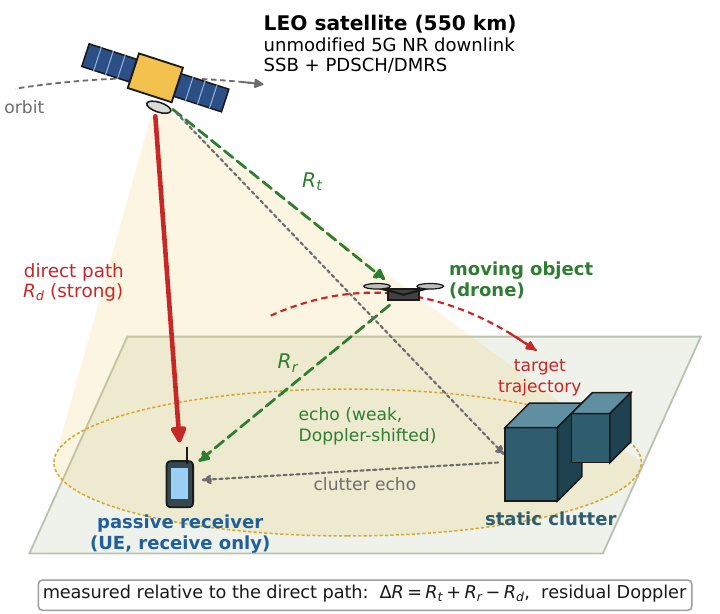
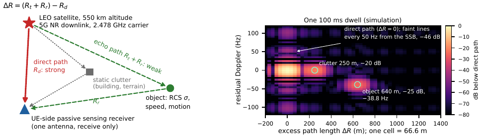
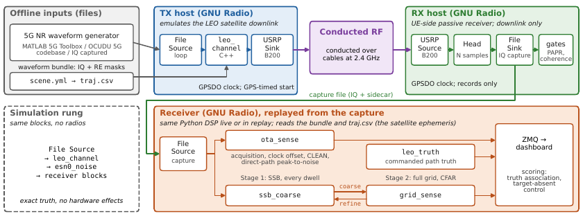
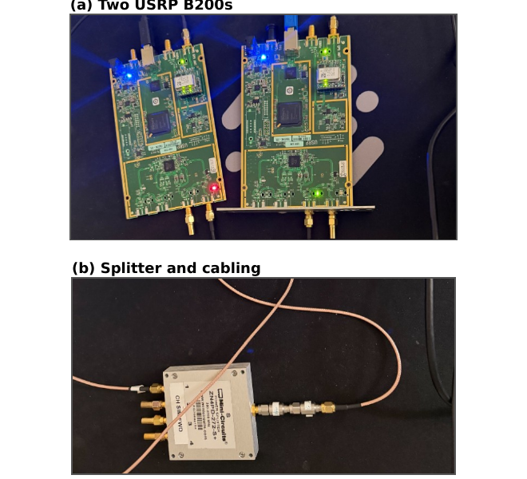
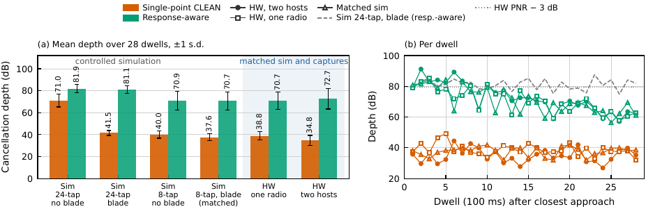

# NTN ISAC (GRCon 2026)

**gr-ntnisac** is an open GNU Radio testbed for non-terrestrial integrated
sensing and communications. It applies an emulated low-Earth-orbit channel to
a standard 5G New Radio downlink, sends that waveform through two cabled USRP
B200s, and scores the receiver against the delay and Doppler commanded for
every path. The same receiver code runs in simulation, on recorded captures,
and on hardware.

The channel and the objects are emulated, and the radios stay on cable with
at least 40 dB of attenuation. The testbed does not claim satellite reception
or a radiated physical target. It tests the receiver on real radios against
known truth. Calibration scripts, lab handoffs, raw IQ captures, and replay
logs are not included here.

## Paper

Soham Dhiren Desai, “gr-ntnisac: An Open GNU Radio Testbed for NTN-ISAC,”
arXiv:2610.11307, 2026.
[arxiv.org/abs/2610.11307](https://arxiv.org/abs/2610.11307)
([PDF](https://arxiv.org/pdf/2610.11307)).

The waveform, scene, and receiver are held fixed from simulation to hardware.
On that path the paper reports:

- Direct-path cancellation of **34.8 dB** on two cabled B200s, and **37.6 dB**
  in a matched simulation with the radios removed.
- A floor near **40 dB** from the emulator’s 8-tap fractional-delay filter and
  from a simulated rotating blade inside the direct path’s delay bin. Without
  either, depth reaches **71.0 dB**. A diagnostic canceller that also removes
  the per-subcarrier response and the per-symbol phase reaches **72.7 dB** on
  the same captures.
- A payload-aided receiver that detects a **−25 dB** moving path in **76.9%**
  of dwells (230 of 299) on a 30 s conducted capture, within one delay bin and
  10 Hz. The weaker rungs at −30, −35, and −40 dB were not detected. That
  scene is [`scenes/ladder.yml`](scenes/ladder.yml).

Talk slides: [`docs/NTN_ISAC_in_GNU_Radio.pptx`](docs/NTN_ISAC_in_GNU_Radio.pptx).

### Figures from the paper

The illuminator is one LEO satellite. The receiver is passive. Excess path and residual Doppler are measured from the direct path.



One simulated dwell. A static scatterer at 250 m and a −25 dB object at 640 m land on the delay and Doppler the scene commanded.



The same receiver runs in simulation, on a recorded capture, and on the conducted bench.



Two GPSDO-locked USRP B200s, a splitter, and fixed attenuation. Nothing in the paper is radiated.



Direct-path cancellation. Single-point CLEAN is about 35 dB on two radios. The response-aware diagnostic reaches about 73 dB on the same captures.



## What you get

- **`gr-ntnisac`** — GNU Radio out-of-tree module (C++ LEO channel + Python
  sensing blocks)
- **`py/ntn_isac`** — shared Python library (OFDM, tracking, two-stage sensing,
  OTA sync, CLEAN, micro-Doppler)
- **`gr/flowgraphs`** — command-line drivers for sim, loopback, TX, and RX
- **`gr-ntnisac/examples/*.grc`** — the same graphs on a GNU Radio Companion
  canvas
- **`matlab/`** — waveform and trajectory generators (run once; not in the
  live path)
- **`data/wf_ota`** and **`data/traj_ota`** — a sample 2478 MHz bundle so you
  can run without MATLAB on the first try

## Requirements

- GNU Radio 3.10 with `gr-uhd`, `gr-zeromq`, `gr-qtgui`, UHD 4.x
- Python packages in **the interpreter GNU Radio was built against**:
  `numpy`, `scipy`, `pyzmq`, `pyqtgraph`
- Optional: MATLAB R2023b+ with 5G Toolbox and Satellite Communications Toolbox
  (only to regenerate waveforms)
- Optional: two USRP B2xx radios. The paper's conducted setup used two B200s,
  each disciplined by its internal GPSDO.

## Build

```sh
cd gr-ntnisac && mkdir -p build && cd build
cmake .. -DCMAKE_INSTALL_PREFIX=$PWD/../install -DCMAKE_BUILD_TYPE=Release \
         -DCMAKE_CXX_FLAGS="-O3 -march=native"
make -j8 && make install
cd ../..
. ./env.sh
```

On macOS, point CMake at the interpreter that has `gnuradio`, for example
`-DPYTHON_EXECUTABLE=/opt/homebrew/bin/python3.14`.

`env.sh` sets `$NTN_PY`, `$NTN_ROOT`, `PYTHONPATH`, and `GRC_BLOCKS_PATH`.
Source it in every terminal you use for this project, including before opening
GNU Radio Companion.

## Simulation (no radios)

Two-stage coarse-to-fine sensing (emulated clutter + drone):

```sh
. ./env.sh
$NTN_PY gr/flowgraphs/twostage.py --wf data/wf_ota --traj data/traj_ota \
    --seconds 2 --t-start 500
```

Over-the-air receive path, still fully simulated (direct-path CLEAN + rotating
target):

```sh
$NTN_PY gr/flowgraphs/ota_rx.py --wf data/wf_ota --traj data/traj_ota \
    --mode sim --seconds 4 --sim-eps-ppm 2.5 --blade-rot-hz 7
```

On a GRC canvas:

```sh
. ./env.sh
gnuradio-companion gr-ntnisac/examples/ntnisac_twostage.grc
gnuradio-companion gr-ntnisac/examples/ntnisac_ota_bench.grc
```

Dashboards:

```sh
$NTN_PY gr/dashboard.py --attach          # two-stage maps
$NTN_PY gr/ota_dashboard.py --launch bench
```

Contract and sensing checks (need the sample bundles above):

```sh
$NTN_PY tests/check_bundle.py data/wf_ota
$NTN_PY tests/verify_twostage.py
$NTN_PY tests/verify_ota.py
```

## Conducted hardware (as in the GRCon paper)

Every hardware result in the paper is **conducted over cable**: two hosts, two
USRP B200s, each locked to its GPSDO, connected through a splitter and fixed
attenuation (at least 40 dB). Nothing is radiated. Capture first, then replay.

One-radio loopback first (TX/RX to RX2 through **≥40 dB** attenuation), to check
sustained streaming and measure the fixed hardware delay:

```sh
$NTN_PY gr/flowgraphs/loopback.py --wf data/wf_ota --traj data/traj_ota
```

Two hosts. Transmit host first; it prints an `--epoch`. Paste that value on
the receive host, do not invent one:

```sh
$NTN_PY gr/flowgraphs/ota_tx.py --tx-args "serial=<TX>" \
    --wf data/wf_ota --traj data/traj_bench --t-start 300 \
    --clock gpsdo --tau-bias 40 --tx-gain 72 --interp-taps 8

$NTN_PY gr/flowgraphs/rx_capture.py --rx-args "serial=<RX>" \
    --wf data/wf_ota --traj data/traj_bench --clock gpsdo --epoch <printed> \
    --t-start 300 --tau-bias 40 --rx-gain 40 --seconds 3 --out data/twohost1.cf32
```

Gate the capture (PAPR within 1.5 dB of the waveform's, no frame-to-frame
splice), then replay it at a desk:

```sh
$NTN_PY gr/flowgraphs/ota_rx.py --mode replay --capture data/twohost1.cf32 \
    --wf data/wf_ota --traj data/traj_bench --t-start 300 --tau-bias 40 \
    --no-emulated --json twohost1.json
```

Build `data/traj_bench` with `tools/build_scene.py scenes/bench.yml`; the
detection ladder in the paper uses `scenes/ladder.yml`. The `ota_*` names are
historical: those blocks were first written for two free-running radios.

## Optional over the air workflow

This workflow is provided by the software but was not used for the GRCon
paper's reported results. The paper uses a cabled, attenuated two-B200 path so
RF hardware impairments coexist with exact commanded scatterer truth.

Read `docs/running.md` section 3 and `docs/ota.md` before transmitting.
Highlights:

- Bundles are at **2478 MHz** (2.4 GHz ISM). Survey the local band first.
- A B200 is about 10 dBm. Check your local rules; in the US this is typically
  FCC Part 15.247 at this bandwidth.
- Indoor delay resolution is ~67 m, so a physical object is **unresolved in
  delay**. The OTA path measures **Doppler** after cancelling the direct path.
  Use a rotating metal blade (~7 or 11 rev/s), not a person walking.

Run the conducted loopback above first. Then two laptops, TX first:

```sh
$NTN_PY gr/flowgraphs/ota_tx.py --wf data/wf_ota --traj data/traj_ota \
        --t-start 300 --clock internal --tx-gain 70
```

Paste the printed receive command on the other laptop. Same graphs as
`ntnisac_ota_tx.grc` / `ntnisac_ota_rx.grc`.

Free-running clocks are enough for the **physical** target. A shared 10 MHz/PPS
reference is required if you also want the **emulated** drone from `Grid Sense`.

## Regenerating data

Python, no MATLAB (orbit + scatterers from a scene file):

```sh
$NTN_PY tools/build_scene.py scenes/bench.yml --plot
```

MATLAB (waveform + 2478 MHz OTA bundles):

```matlab
addpath matlab
gen_ota_bundles                 % data/wf_ota, wf_ota050, traj_ota
```

## Layout

```
py/ntn_isac/     Python library (channel, receiver, sensing, OTA)
gr-ntnisac/      OOT: leo_channel, esn0_noise, leo_truth,
                 ssb_coarse, grid_sense, ota_sense, link_budget
gr/flowgraphs/   twostage, ota_tx, ota_rx, loopback, tx_usrp
matlab/          waveform and trajectory generators
scenes/          YAML channel scenes (compiled by tools/build_scene.py)
docs/            architecture, how to run, OTA, two-stage sensing
```

Start with `docs/architecture.md`, then `docs/running.md`.

## License

`gr-ntnisac` is GPL-3.0-or-later (GNU Radio OOT). The rest of this tree is
released under the same license so the module can be distributed together.
See `LICENSE`.
